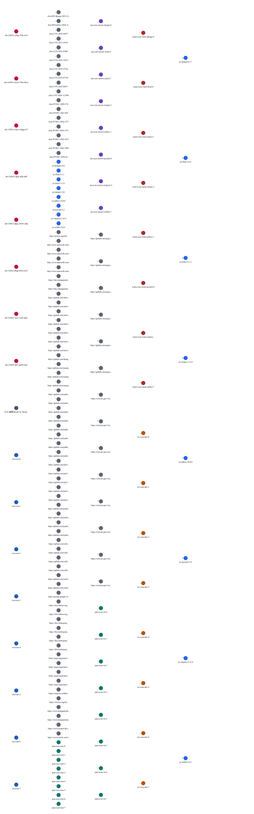

# TraceLens — Claim Freshness Gate

**The lockfile is clean. The sentence is not.**

本产品是一个给开发者和 coding agent 用的**事实有效期门禁**：在 agent 的一句话被下游消费之前，沿 Relate 图把它声称的事实追溯到*该事实成立的那个时刻*，判断它在被写下的瞬间是否已经过期。当前完整落地、可量化实测的实例是 **born-stale 依赖版本声明**——8 个真实 OSV 公告、9 条真实模型输出（6 个包）、5 条真实 Stack Overflow 问答、137 条回归测试。

TraceLens is a pre-merge **claim-freshness gate**. Before a coding agent's answer is trusted, it walks a Relate graph from what the agent *said*, through where it *read* it, to when that fact *actually changed* — and rejects the sentence when it was already stale at the moment it was written. Version identity and the OSV publication clock are the fully measured instance; the same time-aware derivation and minimum-repair machinery is the general mechanism.

> lockfile 是干净的，那句话不是。TraceLens 在合并前审的是 agent 说出口的事实，不是已经落地的依赖文件。

## Judge quickstart（clone → run → see graph，三步不问人）

官方要求：评委应能 clone、run、see graph，无需向作者提问。全程离线，无 server、无 API key、无 signup。

```bash
# 1) clone
git clone https://github.com/guyuezheng33-ai/tracelens-claim-freshness-gate.git
cd "tracelens-claim-freshness-gate/trace-lens"

# 2) run（自建 venv、装包、重建证据、跑 137 测试）
python -m venv .venv && .venv/Scripts/python -m pip install -e ".[dev]"   # Windows
# POSIX: python3 -m venv .venv && .venv/bin/python -m pip install -e ".[dev]"
.venv/Scripts/python -m pytest tests -q

# 3) see graph（双击即可，离线打开四张持久化图）
start docs/graph-explorer.html     # Windows；POSIX: xdg-open docs/graph-explorer.html
```

Windows 也可直接 `.\verify.ps1`（等价第 2 步）+ `.\scripts\graph.ps1`（等价第 3 步）。



*上图不是示意图：`make graph` / `.\scripts\graph.ps1` 用 Cypher 从持久化 `scan.rl` 读回每个节点与边后渲染，随每次复验自动重建。*

## Use case

**Who benefits.** Developers and students who accept code and dependency advice from coding agents. The agent's prose is often the only artefact that survives into the next step: a PR description, an issue reply, a teammate's context. A sentence like `requests 2.2.0 is safe to use` can be read and acted on long after it became wrong.

**The exact failure.** The project's lockfile pins `requests==2.3.0`, so a manifest-only scanner (`pip-audit`, Dependabot, OSV-Scanner) reports **clean**. The agent's text still recommends `2.2.0`, which entered the real OSV advisory range in 2014. The scanner has no input surface for that sentence; the next agent that reads the PR does. TraceLens returns `BLOCK_MERGE_TEXT` with the public advisory URL and the version to pin instead.

**Why this is not another SCA.** SCA reads manifests, lockfiles, SBOMs and built artifacts (verified across Wiz, IBM, Safeguard and Brackets). TraceLens does not compete there — it audits the **natural-language claim** *before* it becomes a lockfile change, and judges it on a **fact clock** (when the claim's premise stopped being true) rather than a version range. The category is **claim freshness**, not "SCA with AI": Q11's Datalog time rules and R5's minimum-repair solve operate on the claim→evidence→fact-change path, which a manifest scanner has no input surface for.

**Problem scale is external, not self-asserted.** PinTrace (arXiv 2605.06279, 1,000 Stack Overflow tasks × 10 LLMs × 267 PyPI libraries) measures that **36.70%–55.70%** of tasks specify a version with a known CVE, **62.75%–74.51%** of those are Critical/High, and **72.27%–91.37%** of the CVEs were public before the model's knowledge cutoff. It is a measurement study; TraceLens is the pre-merge graph tool that window needs.

## How it uses Relate

**Mode.** Persistent single-file Relate store, queried with Cypher through both a Python CLI and a read-only MCP stdio server. No Neo4j server, no cloud account, no API key.

**Why this mode.** The decisive evidence is a *path*, not a value: the claim lives in the answer text, its justification lives in a retrieved document, the vulnerability clock lives in an OSV advisory, and the project's actual choice lives in a lockfile. Joining those four requires typed, variable-length graph traversal; a table join would lose the ordered evidence chain and the per-hop timestamps that make the explanation auditable.

**What the graph models.**

| Nodes | Relationships |
|---|---|
| `Run`, `Span`, `Source`, `Answer`, `Claim`, `PkgVersion`, `Lockfile`, `Advisory`, `Alias`, `Ref` | `CONTAINS`, `PARENT_OF`, `PRODUCED`, `ASSERTS`, `CITES`, `RETRIEVED_FROM`, `MENTIONS`, `PINS`, `AFFECTS`, `HAS_ALIAS`, `REFERENCES` |

`AFFECTS` edges are **derived from each real advisory's affected version ranges**, never hand-labelled. That is what makes the SCA control honest: a pinned version is clean because the advisory does not cover it, not because an edge was omitted. `Alias`/`Ref` nodes come verbatim from each real OSV record's `aliases`/`references` and use the **same keys as the full OSV graph** (`alias:<CVE/PYSEC>`, `Ref.url`), so the audit graph and the 11k-node vulnerability graph share node identity instead of being two disconnected models.

Six graph-native questions (Q6–Q8 return an ordered, explainable path; Q9/Q10 aggregate across answers; Q11 reasons to a fixpoint):

- **Q6 — provenance path.** `(Span)-[:PARENT_OF*0..8]->(Span)-[:RETRIEVED_FROM]->(Source)-[:MENTIONS]->(PkgVersion)<-[:AFFECTS]-(Advisory)-[:HAS_ALIAS*0..1]->(Alias)-[:REFERENCES*0..1]->(Ref)`: which evidence chain carried the stale version into the answer, continued through the advisory's public identity chain. Realized path lengths **vary with the real alias/reference data — 4, 5 and 6 hops in this run (111 paths over 8 declarations)**, not a fixed template.
- **Q7 — hop-level time audit.** An `ALL()` predicate over `nodes(path)` plus per-hop `at_ns`: at which hop was the version already known-vulnerable. In this run the first stale hop is **4421.06 days** after publication, while the source document itself predates the advisory by 365 days — it was correct advice when written, and became stale only when a 2026 agent retrieved it.
- **Q8 — declaration drift.** Join the agent's cited version, the lockfile's pinned version and the advisory timeline, and resolve the advisory's CVE/PYSEC aliases in the same query — the reject action carries cross-database identifiers read from the graph. This is the decision a manifest-only scanner cannot make.
- **Q9 — cross-model convergence.** In one merged store of 22 captured answers, group distinct models around the same `PkgVersion` a real advisory `AFFECTS`: e.g. **claude-sonnet-4-6 and gemini-3.1-pro-preview independently cite pillow 10.0.0**. The PinTrace paper calls this systemic bias; here it is a fan-in query over captured outputs, not a quoted statistic.
- **Q10 — advisory blast radius.** Fan out from one `Advisory` node over `AFFECTS <- CITES <- ASSERTS`: the pillow advisory **GHSA-22hg-r758-rrw9 turns 5 captured answers from 5 models born-stale at once**. A per-file scanner has no cross-answer view at all.
- **Q11 — fixpoint rule reasoning → minimum repair.** Four Datalog-style rules derive born-stale from first principles rather than re-running the Q8 pattern: R1 a source predates the advisory → R2 a retriever pulls that stale advice after publication → R3 the stale advice propagates recursively along the span tree (data-downstream) → R4 the produced answer is born-stale **only for the advisory affecting the exact version it cites** (CITES guard, no cross-advisory product). The rules iterate to a **fixpoint (40 derived facts, 2 iterations)**, every fact carries its rule + premises, and the derived set is **cross-checked against the independent Cypher Q8 computation (agreement PASS)**. Then **R5 solves a minimum set cover over producer→stale-source paths** and **R6 verifies the plan blocks every derived answer**. On the real 8 independent review chains that is 8 cuts (one per chain); on the **shared-collector counterfactual** — the same 8 real advisories, 8 real source documents, one batch retriever — **a single cut covers all 8 answers** (`docs/reasoning-verdict.json`, `docs/reasoning-shared-verdict.json`). A per-answer boolean (Q8) cannot express "fix the collection layer once"; this is constrained optimisation on the graph, not a second derivation.

**Ask the store anything.** `python -m tracelens.ask --store <file.rl> --cypher "..."` is a read-only Cypher console (write clauses are refused), so a judge can run arbitrary queries against any persisted store, not just the guided highlights.

**Falsifiable, not constant-true.** Holding the advisory and the version fixed and only moving the answer wall-clock (`--as-of`) flips the verdict: a 2013 answer is clean, a 2026 answer is born-stale. `docs/expiry-counterfactual.json` records the five checks. `fix_available_ns` is taken from data only; OSV's record-edit time is named `osv_modified_ns` and never passed off as a fix time.

**See the graph.** `docs/graph-explorer.html` is **committed to the repo — double-click it and the four graphs are there, no script, no install, no network**. It reads back **four** persisted stores with Cypher — every node, property and edge is from the `.rl` file, not a diagram. Click a node to see all its stored properties and edges; highlight Q6–Q10 to walk the exact paths returned in this run. The **OSV full graph (11,023 nodes / 50,952 relationships)** opens in an interactive mode: search any node, walk its neighborhood by clicking, and query a path between any two nodes (≤8 hops) — all client-side, still offline. `make verify` / `.\verify.ps1` **already rebuilds all four exports and the explorer** as part of verification; `make graph` / `.\scripts\graph.ps1` is only a convenience when you want to re-open the explorer without re-running the tests.

```bash
cd trace-lens
python -m tracelens.graphexport --store real-traces/scan/scan.rl \
  --verdict docs/scan-verdict.json --out docs/graph-scan.json --title "批量 8 包 · scan 图"
python -m tracelens.graphexplorer --graph docs/graph-provenance.json \
  --graph docs/graph-scan.json --graph docs/graph-convergence.json \
  --graph docs/graph-osv.json --out docs/graph-explorer.html
# 或者一步：make graph（POSIX）/ .\scripts\graph.ps1（Windows）
```

## Setup and run

```bash
make verify     # POSIX：自建 trace-lens/.venv、装包、重建全部产物、跑 137 测试、生成证据包
make graph      # POSIX：重建四张图的导出并直接打开离线 graph-explorer.html
```

```powershell
.\verify.ps1            # Windows 原生：与 make verify 逐步等价，无需 make / Git Bash
.\scripts\graph.ps1     # Windows 原生：一步看图
```

`make verify` / `.\verify.ps1` 是一步入口；脚本内部才做 `python -m venv` 与 `pip install -e .[dev]`，评委不需要手填 `TRACELENS_PYTHON`。`make graph` 是一步看图的入口，不需要先记 export 命令。 The evidence pack reads its test count from **that run's log**, never from a remembered number. This run: **8 real advisories → 8 declarations → 111 variable-length provenance paths (4–6 hops) → 8 declaration drifts → 8 `BLOCK_MERGE_TEXT` actions**, with the SCA control clean on all 8 pins; **9 real model outputs (6 packages) and 5 real public Stack Overflow cases also blocked**; **Q9 finds cross-model convergence and Q10 measures advisory blast radius on 22 merged answers**; **137 tests passed**; graph exports **PASS** for all four stores. The persisted real OSV graph has **11,023 nodes / 50,952 relationships / 873 vulnerabilities**, and the batch audit graph shares its Alias/Ref identity keys, so the connected-context claim is measured on real graphs, not a toy demo. See `trace-lens/docs/EVIDENCE.md` (numbers generated by `python -m tracelens.evidence`).

真实输入面不是自写 demo：**批量主 demo 的 8 条声明本身就是真实模型输出**（`real-traces/scan/pr-answer.txt`，逐条来源见 `pr-answer-sources.json`，保留 model 与 task id）；lockfile 的 pin 是场景配置（设为各 advisory 的 fixed 版本，即“项目已经钉好的版本”）。`trace-lens/real-cases/cases.json` 的 9 条主案例同样取自 PinTrace 公开评估数据里的**真实模型输出**（覆盖 flask / pillow / requests / django / numpy / jinja2 六个包）；`trace-lens/real-cases/real-user/` 另存 5 条真实 Stack Overflow 问答。全部 14 条都在 `scan-verdict.json` 里跑出 `BLOCK_MERGE_TEXT`，每条有 Q6 路径、Q7 逐跳审计和 Q8 漂移。你可以直接重跑任意一条：

```bash
cd trace-lens
python -m tracelens.scan --text real-cases/real-user/stackexchange-62945229/text.txt \
  --lockfile real-cases/real-user/stackexchange-62945229/requirements.lock \
  --passport real-traces/scan/osv-batch-passport.json \
  --as-of 2026-11-24T00:00:00Z --store /tmp/so.rl --out /tmp/so-verdict.json
```

The one-command scan over arbitrary text and a lockfile, fully offline against a real OSV passport:

```bash
cd trace-lens
python -m tracelens.scan --text real-traces/scan/pr-answer.txt \
  --lockfile real-traces/scan/requirements.lock \
  --passport real-traces/scan/osv-batch-passport.json \
  --store real-traces/scan/scan.rl --out docs/scan-verdict.json
```

An agent can call the same graph through a read-only MCP stdio server (`python -m tracelens.mcpserver --store store/demo-run.rl`); write operations are rejected. The guardrail uses graph evidence only — a real model may write the explanation text but cannot override a graph rejection.

## Where the data lives

All stores are persistent single files under `trace-lens/real-traces/`:

| Store | What it contains |
|---|---|
| `provenance/provenance.rl` | unified trace + advisory + lockfile graph, **19 nodes / 19 relationships** |
| `scan/scan.rl` | 8-package batch from real OSV advisories + 8 captured model outputs, **162 nodes / 175 relationships** |
| `convergence/convergence.rl` | 22 captured answers merged for Q9/Q10, **269 nodes / 296 relationships** |
| `osv/osv-graph.rl` | OSV.dev 真实全量图，**11,023 nodes / 50,952 relationships / 873 vulnerabilities** |
| `expiry/expiry.rl`, `expiry/cf-before.rl`, `expiry/cf-after.rl` | Q5 born-stale and its time counterfactual |
| `store/demo-run.rl` | Q1–Q4 diagnostic demo for the MCP server |

Public-data passports (each records source URL, sha256 and `nature`): `real-traces/scan/osv-batch-passport.json` (8 real OSV records with affected ranges, aliases and references), `real-traces/osv/osv-passport.json`, `real-traces/expiry/advisories.json`. Raw OSV records are committed under `real-traces/osv/records/` and read offline-first (id re-validated); the batch passport's references were copied verbatim from the same committed `osv-snapshot.json` that built the full OSV graph. The agent trace is a **self-run** (real TF-IDF scoring, real wall-clock timestamps, no customer) — stated in the passport caveat, never presented as production traffic. Network is needed only to capture a new OSV record; after the one-time `pip install`, judging, scanning and graph exploration all run offline from committed data.

**One real public catch is packaged verbatim.** `trace-lens/public-catches/catch-001-minimax-flask-230/` holds a captured model-output line from the public PinTrace evaluation file (`direct_dependencies.jsonl` line 146, `BigCodeBench/81`, `MiniMax-M2.5`): `from flask import Flask  # VERSION=2.3.0`. TraceLens blocks it against `GHSA-4grg-w6v8-c28g` (alias `CVE-2025-47278`, fixed 3.1.1) with the full Q6 identity path, reproducible offline. It is a **captured public model output, not a paying customer** — `source.json` says so explicitly, and records that upstream marks two other CVEs while the gate matched this one.

## Repository map

- `trace-lens/` — runnable CLI, modules, tests, stores and evidence artefacts. `trace-lens/README.md` is the engineering index.
- `scripts/award-verify.sh` / `scripts/award-verify.ps1` — one-command rebuild + verification (POSIX / Windows); `verify.ps1` is the Windows root entry; `scripts/verify.sh` — earlier Q1–Q4 baseline.
- `trace-lens/docs/EVIDENCE.md` — programmatic evidence pack; `trace-lens/docs/first-place-benchmark.json` — sourced official-rule quotes, historical winner profiles and competitor boundary (an external-verification archive, not a scoring standard).
- `trace-lens/demo/shotlist.md` — 1–2 minute demo storyboard; `trace-lens/docs/graph-explorer.html` — offline graph browser (4 stores, interactive OSV mode).
